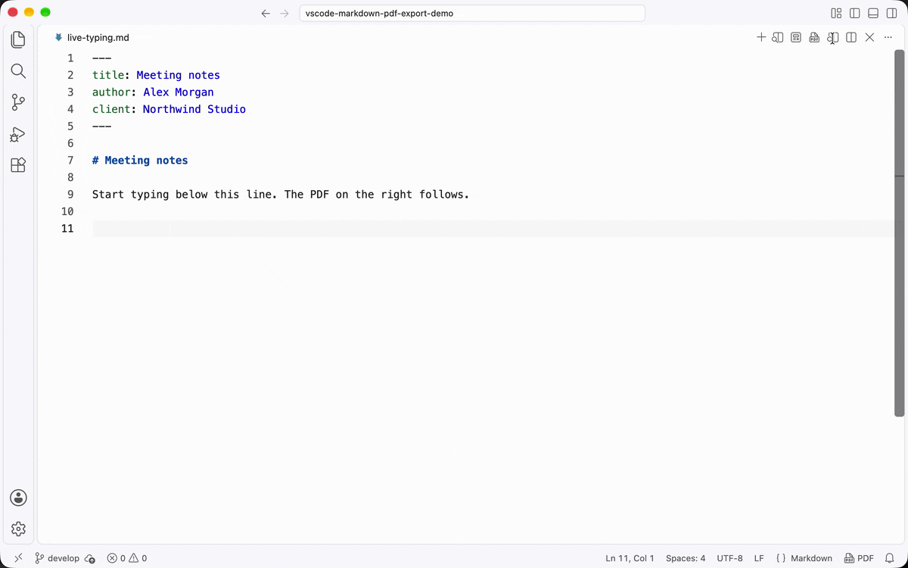
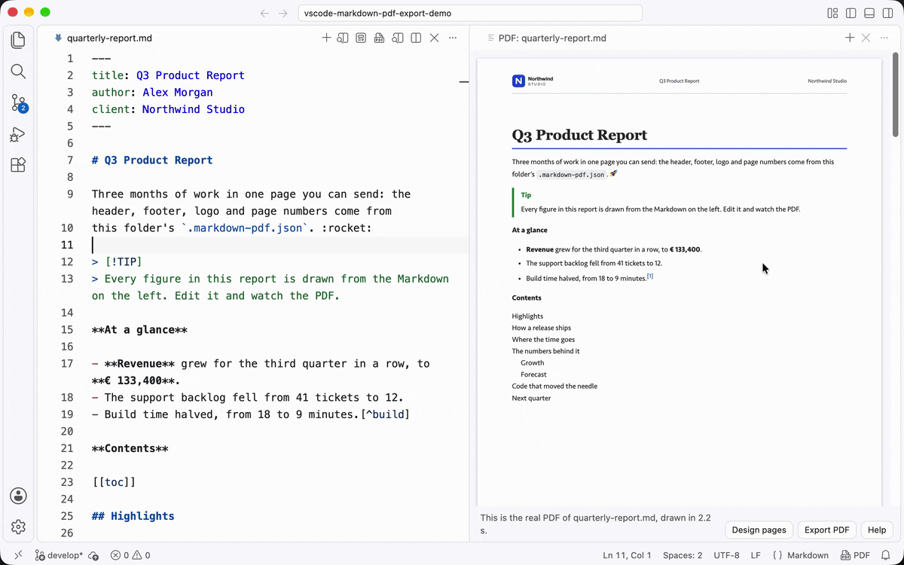
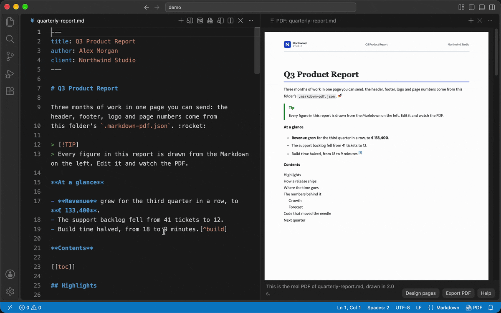

# Markdown PDF Export for VS Code

**The real PDF beside your Markdown, as you type.**

Design the header, footer, page numbers and logo by clicking, then export. No Node.js, no
terminal, no HTML templates.



New here? **Markdown PDF: Get Started** in the Command Palette (or **Get Started** in the **PDF**
menu of the status bar) opens a short tour: preview, design, export.

## Everything Markdown can say

Tables, diagrams, maths, alerts: it all shows in the preview and prints in the PDF.



- **Tables**, with alignment.
- **Task lists**: real ticked and empty checkboxes.
- **Mermaid diagrams**: flowcharts, sequence and Gantt charts, pie charts and the rest, drawn
  on your computer as vector graphics that stay sharp when zoomed.
- **Maths** with KaTeX: `$A = \pi r^2$` inline, `$$…$$` centred (`math: true`).
- **Alerts**: GitHub's `[!NOTE]`, `[!TIP]`, `[!IMPORTANT]`, `[!WARNING]` and `[!CAUTION]`.
- **Emoji**: `:tada:` shortcodes and emoji typed directly.
- **Footnotes**, numbered and collected at the end with links back.
- **Code blocks**, coloured by language.
- **Heading IDs**: every heading gets an id, so `[the results](#results)` jumps to it in the PDF.
- **Table of contents**: `[[toc]]` on its own line (`toc: true`).
- **Page breaks**: `<div class="page-break"></div>` or `<!-- page-break -->`.

Details and examples: [Content](https://markdown-pdf.matinfo.tech/advanced/content).

## Design pages by clicking

Professional pages without writing CSS or HTML: pick a page style, fonts and paper, click a spot
of the page to put the title, page numbers, date or logo there, and every choice shows on the
real PDF at once.



Click **Design pages** in the preview panel, or run **Markdown PDF: Design Pages**. Press
**Save** to keep the design. Each section has a **Help** link to its page of the documentation.

The design lives in one settings file, shared with the `markdown-pdf-export` command line and the
other editors: `~/.config/markdown-pdf-export/settings.json`
(`%APPDATA%\markdown-pdf-export\settings.json` on Windows). A `.markdown-pdf.json` file in a
folder changes it for that folder only. **Design pages** always edits the design the PDF uses:
that folder file when one applies to the document in front, your settings file otherwise.
**Design Pages for This Folder Only** starts a folder design where there is none yet.

More in the documentation:

- [Settings file](https://markdown-pdf.matinfo.tech/advanced/settings-file): where it lives and how files are combined.
- [Header and footer](https://markdown-pdf.matinfo.tech/advanced/header-footer): zones, logos, page numbers and dates.
- [Header and footer reference](https://markdown-pdf.matinfo.tech/reference/header-footer): every option, placeholder and
  image setting.
- [All settings](https://markdown-pdf.matinfo.tech/reference/settings).

To edit the file by hand, run **Markdown PDF: Open Settings File**: VS Code completes and checks
the setting names as you type. A file saved by **Design pages** names its schema on
markdown-pdf.matinfo.tech (`$schema`); the first time you open one, the extension asks whether
VS Code may load it from there. A file without `$schema` uses the copy inside the extension, with no network connection.

## See the PDF while you write

Open a Markdown file and click the preview button at the top right of the editor (or run
**Markdown PDF: Open PDF Preview to the Side**). The panel shows the PDF itself, with its pages,
header, footer and page numbers, not an approximation:

- it is drawn again shortly after you stop typing, saved or not
  (`markdownPdfExport.preview.refresh` set to `onSave` waits for a save);
- it follows the Markdown file you bring to the front;
- raw HTML left out for safety and diagrams that could not be drawn are listed in the **Problems** panel, on the line that caused them.

**Design pages**, **Export PDF** and **Help** are at the bottom of the panel.

## Export

Open a Markdown file, then any of:

- press **Cmd+K Cmd+E** (Mac) or **Ctrl+K Ctrl+E** (Windows, Linux);
- click the PDF button at the top right of the editor;
- right-click the file (in the editor or the Explorer) → **Export to PDF**;
- Command Palette → **Markdown PDF: Export to PDF**.

The PDF is written next to the Markdown file.

## Ask your AI assistant

An other simple way to ask your AI assistant to export a Markdown file to PDF is to use Copilot Chat's agent mode. In this mode, ask *Export this file to PDF* or *Open Studio*. The tools are offered by the extension; there is nothing to set up.

## One document, its own design

At the top of a Markdown file, a `pdf:` block changes only that document. VS Code suggests the keys and their values as you type, and the preview shows the result:

```yaml
---
title: Quarterly report
author: Jane Smith
pdf:
  orientation: landscape
  footer:
    center_text: "Draft, page {page}"
---
```

`{author}` prints the document's `author:`. To print the same name in every document, add
`"author": "Jane Smith"` to your settings file; `author: none` in a document leaves it out there.

Every key of the `pdf:` block, with examples:
[One document, its own design](https://markdown-pdf.matinfo.tech/advanced/per-document).

## Install

Install it from the [Visual Studio Marketplace](https://marketplace.visualstudio.com/items?itemName=matinfo-tech.markdown-pdf-export) or [Open VSX](https://open-vsx.org/extension/matinfo-tech/markdown-pdf-export) (for VSCodium and other editors that install from there), or search for **Markdown PDF Export** in the Extensions view.

## Requirements

- Google Chrome or Microsoft Edge. If neither is installed, the extension offers to download a
  browser for itself (about 200 MB, once).
- Nothing else: no Node.js, no terminal. The exporter,
  [markdown-pdf-export](https://markdown-pdf.matinfo.tech), ships inside the extension.

## Something not working?

Click **PDF** in the status bar (bottom right, in a Markdown file) → **Check Setup**. It tells you which browser and which settings files are used.

**Markdown PDF: Open Documentation** (also in that menu, and **Help** in the PDF panel) opens a
page of the documentation: header and footer, one document's own design, all settings, and
[common problems](https://markdown-pdf.matinfo.tech/help).

## Languages

English and French. With VS Code's display language set to French, the extension speaks French:
commands, settings, the Get Started walkthrough, the **PDF** menu, messages, the Problems
entries, and the PDF panel with its design controls. Footers that Studio sets up are then written
in French too (`Page {page} sur {pages}`). In `pdf:` suggestions, the help for `title`, `author`
and `pdf` is in French; the description of each page setting comes from the PDF engine and is in
English, as are the engine's messages and the documentation.

## Privacy

The export runs on your computer. The extension has no telemetry and sends your documents
nowhere. It goes online only for what a document or its styles load from the web (such as an
image link), and when you ask it to download a browser or allow the settings schema. Details in the [Privacy Policy](PRIVACY_POLICY.md).

<details>
<summary><b>Coming from Markdown PDF (<code>yzane.markdown-pdf</code>)?</b> Most of its settings map straight across, and you get what it never had: the live PDF preview, and page design by clicking instead of HTML templates.</summary>

The settings of *Markdown PDF* (`yzane.markdown-pdf`) have a place here too, but in the settings
file above (or a document's `pdf:` block), not in VS Code's settings:

| Markdown PDF (`markdown-pdf.…`) | Here |
|---|---|
| `headerTemplate`, `footerTemplate` (HTML) | `header`, `footer`: text, logo and placeholders such as `{page}` / `{pages}` in three zones, or click them in **Design pages** ([reference](https://markdown-pdf.matinfo.tech/reference/header-footer)) |
| `displayHeaderFooter` | `display_header_footer` |
| `format`, `orientation` | `page_format`, `orientation` |
| `margin.top`, `.bottom`, `.left`, `.right` | `margin.top`, `.bottom`, `.left`, `.right` |
| `styles` | `stylesheet_path` (one CSS file), or a page style in **Design pages** |
| `includeDefaultStyles` | `include_default_styles` |
| `highlight`, `highlightStyle` | `highlight`, `highlight_style` |
| `breaks`, `emoji` | `breaks`, `emoji` |
| `math.enabled`, `math.katex.macros` | `math`, `math_options.macros` |
| `printBackground`, `scale`, `pageRanges` | `print_background`, `scale`, `page_ranges` |
| `outputDirectory` | `output_directory` |
| `sanitize` | `sanitize` (`safe` or `none`) |
| `mermaidServer` | not needed: diagrams are drawn on your computer |
| `executablePath` | VS Code setting `markdownPdfExport.browser` |

Not here: HTML, PNG and JPEG output (PDF only), convert on save, PlantUML and file includes.
[All settings](https://markdown-pdf.matinfo.tech/reference/settings).

</details>

## Development

```sh
npm ci
npm run ci                 # typecheck, lint, unit tests, build
npm run test:integration   # runs the export inside a real VS Code
```

To try the extension in a new VS Code window: `npm run build && code --extensionDevelopmentPath="$PWD"`.

## License

[MIT](LICENSE). See also the [Terms of Use](TERMS_OF_USE.md), the [EULA](EULA.md) and the
[third-party licenses](THIRD_PARTY_LICENSES.md).
