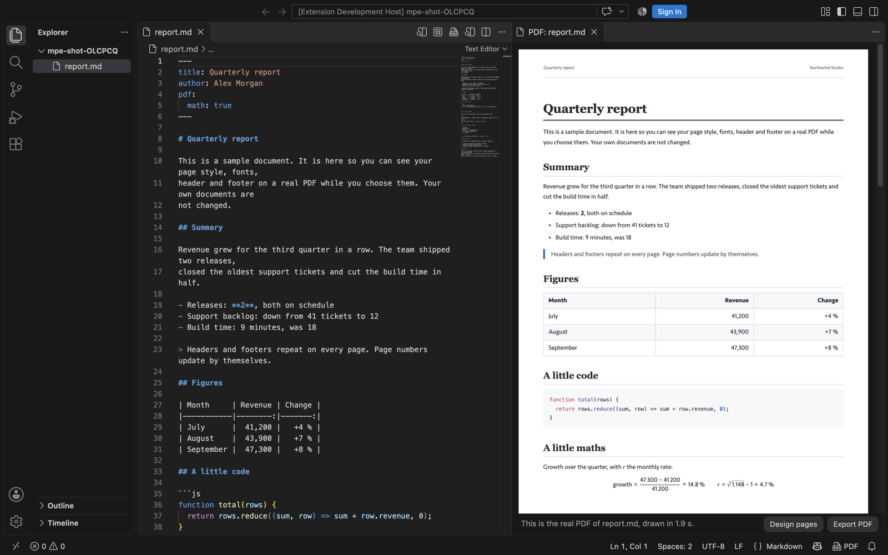
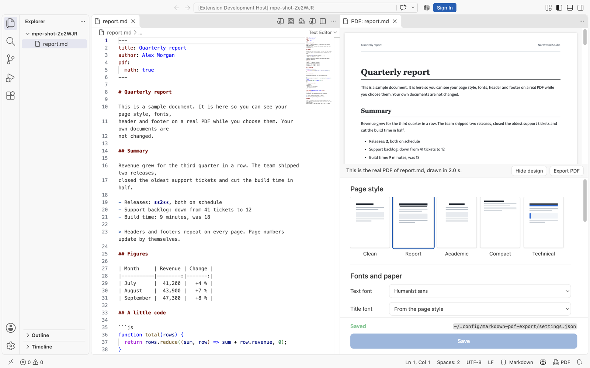

# Markdown PDF Export for VS Code

The real PDF beside your Markdown, as you type. Design the header, footer, page numbers and logo
by clicking, then export.

> **In development.** Not on the Marketplace yet.



## See the PDF while you write

Open a Markdown file and click the preview button at the top right of the editor (or run
**Markdown PDF: Open PDF Preview to the Side**). The panel shows the PDF itself, with its pages,
header, footer and page numbers, not an approximation:

- it is drawn again shortly after you stop typing, saved or not
  (`markdownPdfExport.preview.refresh` set to `onSave` waits for a save);
- it follows the Markdown file you bring to the front;
- raw HTML left out for safety and diagrams that could not be drawn are listed in the **Problems**
  panel, on the line that caused them.

**Design pages** and **Export PDF** are at the bottom of the panel.

## Export

Open a Markdown file, then any of:

- press **Cmd+K Cmd+E** (Mac) or **Ctrl+K Ctrl+E** (Windows, Linux);
- click the PDF button at the top right of the editor;
- right-click the file (in the editor or the Explorer) → **Export to PDF**;
- Command Palette → **Markdown PDF: Export to PDF**.

The PDF is written next to the Markdown file.

## Requirements

- Google Chrome or Microsoft Edge. If neither is installed, the extension offers to download a
  browser for itself (about 200 MB, once).
- Nothing else: no Node.js, no terminal. The exporter,
  [markdown-pdf-export](https://markdown-pdf.matinfo.tech), ships inside the extension.

## One document, its own design

At the top of a Markdown file, a `pdf:` block changes only that document. VS Code suggests the keys
and their values as you type, and the preview shows the result:

```yaml
---
title: Quarterly report
author: Jane Smith
pdf:
  orientation: landscape
  footer:
    center_text: "Draft, page {page}"
---
```

`{author}` prints the document's `author:`. To print the same name in every document, add
`"author": "Jane Smith"` to your settings file; `author: none` in a document leaves it out there.

## Page design



Click **Design pages** in the preview panel, or run **Markdown PDF: Design Pages**. The page
style, fonts, paper, header, footer and logos appear with the PDF, and every choice shows on it
at once. Press **Save** to keep the design.

Page style, fonts, header, footer and logos live in one settings file, shared with the
`markdown-pdf-export` command line and the other editors:
`~/.config/markdown-pdf-export/settings.json` (`%APPDATA%\markdown-pdf-export\settings.json` on
Windows). A `.markdown-pdf.json` file in a folder changes them for that folder only.
See [the documentation](https://markdown-pdf.matinfo.tech).

To edit the file by hand, run **Markdown PDF: Open Settings File**: VS Code completes and checks
the setting names as you type. A file saved by **Design pages** names its schema on
markdown-pdf.matinfo.tech (`$schema`); the first time you open one, the extension asks whether
VS Code may load it from there. A file without `$schema` uses the copy inside the extension, with
no network connection.

## Ask your AI assistant

In Copilot Chat's agent mode, ask *Export this file to PDF* or *Open Studio*. The tools are offered
by the extension; there is nothing to set up.

## Something not working?

Click **PDF** in the status bar (bottom right, in a Markdown file) → **Check Setup**. It tells you
which browser and which settings files are used.

## Privacy

The export runs on your computer and sends nothing anywhere.

## Development

```sh
npm ci
npm run ci                 # typecheck, lint, unit tests, build
npm run test:integration   # runs the export inside a real VS Code
```

To try the extension in a new VS Code window: `npm run build && code --extensionDevelopmentPath="$PWD"`.

## License

MIT
