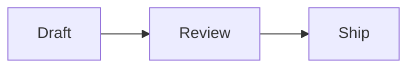

# Markdown PDF Export: demo folder

Sample documents for recording the GIF and screenshots of the
[Markdown PDF Export extension](https://marketplace.visualstudio.com/items?itemName=matinfo-tech.markdown-pdf-export).
Everything here is fictional ("Northwind Studio", "Alex Morgan"), so nothing personal ends up in a
recording.

| File | Shows |
|---|---|
| `.markdown-pdf.json` | This folder's design: *Report* page style, blue accent, fonts, margins, a logo in the header, `{title}` / `{client}` / `{author}` / `Page {page} of {pages}` / `{date}`, maths with macros, contents list. It replaces your own header and footer zones while you record. |
| `quarterly-report.md` | The showcase, 4 pages: cover with a GitHub alert, key figures and a contents list; a table; a flowchart, a sequence diagram and a pie chart (Mermaid, in brand colours); maths (KaTeX: fractions, products, ℝ, 𝔼, 𝒩, a matrix); TypeScript code; a task list; an *Important* alert; a footnote; emoji; a page break. |
| `roadmap.md` | One document, its own design: a `pdf:` block turns it to landscape and changes the footer (`{version}` custom variable). A Gantt chart. |
| `live-typing.md` | Nearly empty, to type into while recording the live preview. |
| `assets/northwind-logo.svg` | The demo logo used in the header. |

> [!IMPORTANT]
> Record with extension **0.1.2 or later** (exporter 2.9.1). Before that, maths prints in a
> fallback font instead of KaTeX's own fonts, and **Design pages** edits your own settings file
> instead of this folder's design.

## Before recording

1. Open this folder in VS Code (**File → Open Folder…**) and trust it: a folder's
   `.markdown-pdf.json` is ignored in Restricted Mode.
2. `.vscode/settings.json` already hides the minimap, wraps long lines and sets a readable font
   size. Also:
   - Pick the default dark theme (**Preferences: Color Theme → Dark (Visual Studio)**).
   - Close other panels and tabs; hide the Activity Bar if you like (**View → Appearance**).
   - Window size about **1280 × 800**. Bigger windows make heavy GIFs.
3. Run **Markdown PDF: Check Setup** once, so the first preview is not slowed by a browser check.

## Shot list

Record each shot as its own clip; short clips loop better than one long one. To record them by
script instead of by hand, see [`recording/`](recording/README.md).

**1. Live preview (the README's first GIF, 15–20 s).** Open `live-typing.md`, click the preview
button at the top right (**Open PDF Preview to the Side**). Type slowly, pausing after each block so
the PDF catches up:

````markdown
## Decisions

- Ship the **invoice** style in January
- Price stays at **€ 12** per seat

Growth target: $G = (1 + g)^4 - 1$


````

**2. Design pages (10–15 s).** With `quarterly-report.md` and its preview open, click
**Design pages** in the preview panel. It edits this folder's `.markdown-pdf.json`, the design the
PDF uses. Pick another page style (for example *Technical*), then click the top right spot of the
small page and press **Page 1 of 9**. The PDF follows each click. Click **Hide design** without
**Save** to keep the demo design; if you save, Studio keeps the previous file as a `.bak` copy next
to it, to copy back.

**3. Showcase scroll (8–10 s).** Open `quarterly-report.md` with its preview and scroll the PDF:
cover, table, diagrams, maths, code.

**4. Export (5 s).** Press <kbd>Cmd</kbd>+<kbd>K</kbd> <kbd>Cmd</kbd>+<kbd>E</kbd> (or the button at the top
right). The PDF opens.

**5. One document, its own design (5 s).** Open `roadmap.md`: landscape page and its own footer,
while the header still comes from the folder.

## From screen recording to GIF

On a Mac, record with <kbd>Cmd</kbd>+<kbd>Shift</kbd>+<kbd>5</kbd> (or [Kap](https://getkap.co)), then:

```sh
brew install ffmpeg gifski
ffmpeg -i shot.mov -vf "fps=12,scale=1200:-1:flags=lanczos" frames/%04d.png
gifski --fps 12 --width 1200 --quality 90 -o demo.gif frames/*.png
```

Aim for under 8 MB per GIF. Lower the width (960) or the frame rate (10) if it is bigger.

The Marketplace page shows images but not videos, so use GIFs (or PNG screenshots) in the README.
