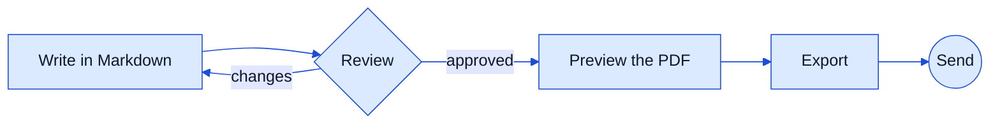
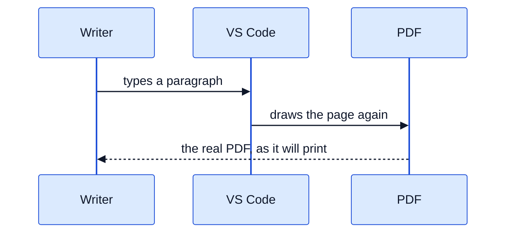
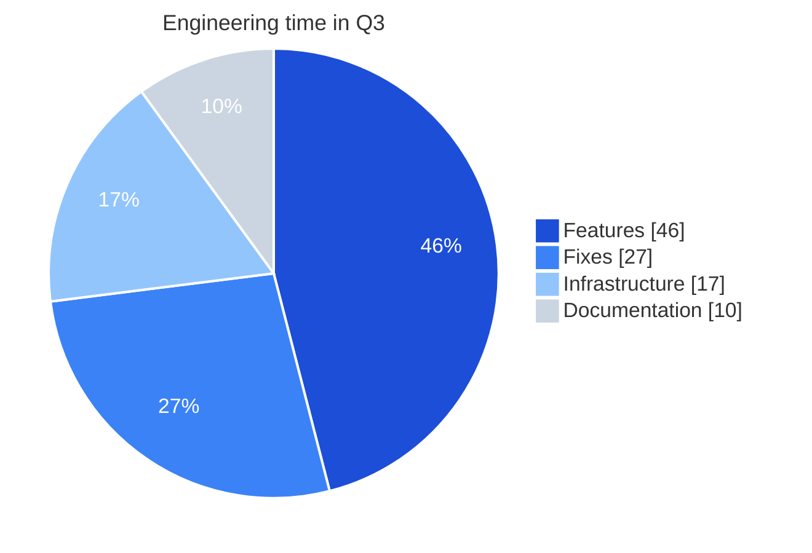

# Q3 Product Report

Three months of work in one page you can send: the header, footer, logo and page numbers come from
this folder's `.markdown-pdf.json`. :rocket:

> [!TIP]
> Every figure in this report is drawn from the Markdown on the left. Edit it and watch the PDF.

**At a glance**

- **Revenue** grew for the third quarter in a row, to **€ 133,400**.
- The support backlog fell from 41 tickets to 12.
- Build time halved, from 18 to 9 minutes.[^build]

**Contents**

[[toc]]

## Highlights

Revenue by month, with the releases that shipped:

| Month     | Revenue | Change | Releases |
|-----------|--------:|-------:|:--------:|
| July      |  41,200 |   +4 % |    1     |
| August    |  43,900 |   +7 % |    1     |
| September |  48,300 |  +10 % |    2     |
| **Total** | **133,400** |    |  **4**   |

## How a release ships





<div class="page-break"></div>

## Where the time goes



## The numbers behind it

### Growth

Monthly growth is $g_t = \frac{R_t - R_{t-1}}{R_{t-1}}$, and the quarter compounds it:

$$
G = \prod_{t=1}^{3} (1 + g_t) - 1 \approx 22.4\,\%
$$

### Forecast

With revenue $R \in \RR^{+}$ and a noise term $\varepsilon \sim \mathcal{N}(0, \sigma^2)$, the next
quarter's expected revenue is

$$
\E[R_{t+1}] = \alpha + \beta R_t, \qquad
\begin{pmatrix} \alpha \\ \beta \end{pmatrix}
= (X^\top X)^{-1} X^\top y
$$

## Code that moved the needle

```ts
// Cache the rendered pages: only redraw what changed.
export function growth(previous: number, current: number): number {
  return (current - previous) / previous;
}

const quarter = [41_200, 43_900, 48_300];
console.log(quarter.map((r, i) => (i ? growth(quarter[i - 1], r) : 0)));
```

## Next quarter

- [x] Ship the live PDF preview
- [x] Publish to the Marketplace and Open VSX
- [ ] Reach 1,000 installs
- [ ] Add a second page style for invoices

> [!IMPORTANT]
> The forecast assumes the same team size. Hiring changes the numbers.

Questions? Write to the team, or read <https://markdown-pdf.matinfo.tech>.

[^build]: Measured on the main branch, median of 50 runs.
