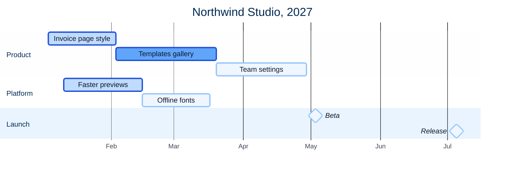

# 2027 Roadmap

This document has its own design: the `pdf:` block at the top turns the page to **landscape** and
changes the footer. Everything else still comes from the folder's settings.

| Quarter | Theme       | Goal                              |
|---------|-------------|-----------------------------------|
| Q1      | Polish      | Invoice style, faster previews    |
| Q2      | Teams       | Templates gallery, beta           |
| Q3      | Scale       | Team settings, release            |
